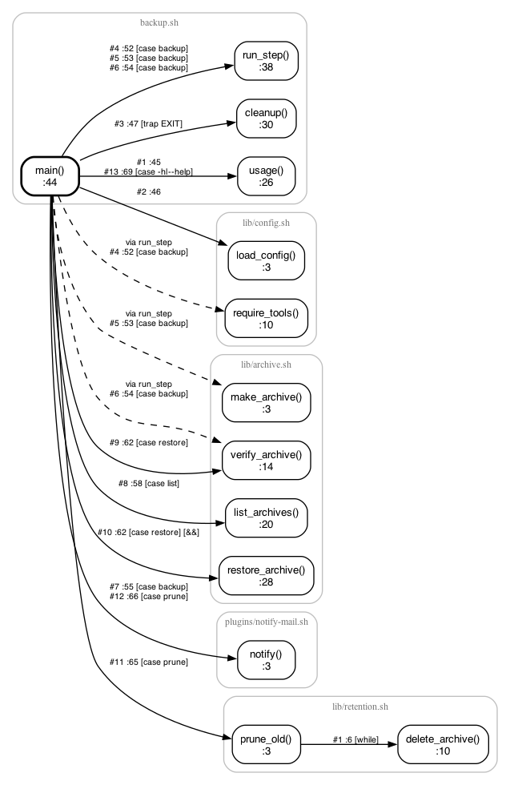

# calltree

A static call tree for Bash projects. `calltree` follows `source` / `.` includes,
finds every function and prints what each one calls, in the order the code runs
it, with the `file:line` of every call and the control flow around it
(`[then]`, `[||]`, `[case backup]`, `[trap EXIT]`, ...).

It never runs your script. It is one Python 3 file with no dependencies, plus an
optional MCP server so Claude Code and other MCP clients can use it.

```
$ cd examples/backup
$ ../../calltree.py backup.sh --to delete_archive
backup.sh
└─ :77  main "$@"  -> backup.sh:44
    └─ :65  prune_old  [case prune]  -> lib/retention.sh:3
        └─ :6  ★ delete_archive "$file"  [while]  -> lib/retention.sh:10
```



## Install

Python 3.9 or newer. Graphviz (`dot`) is needed only for images and GIFs.

```bash
git clone https://github.com/kpatr1981/calltree_server.git
cd calltree_server
ln -s "$PWD/calltree.py" ~/.local/bin/calltree   # optional
```

## Usage

```bash
calltree script.sh                          # whole tree from the top level
calltree script.sh -e main -d 2             # start at a function, two levels deep
calltree script.sh --to delete_archive      # only paths that reach a function (★)
calltree script.sh --callers die            # every call site of a function
calltree script.sh --list                   # function index with call counts
calltree script.sh -H log,die -I '^debug_'  # hide functions by name or regex
calltree script.sh -x                       # also show external commands
calltree script.sh -s rm,psql               # show only these external commands
calltree script.sh --var NAME=path.sh       # value for `source "$NAME"`
```

Exports write a file instead of printing (`-` means stdout):

```bash
calltree script.sh -e main --graph calls.svg     # .svg .png .pdf .dot
calltree script.sh --json calls.json --yaml calls.yaml
calltree script.sh --to delete_archive --subset path.sh
calltree script.sh -e main -d 2 --animate run.gif --delay 0.8
```

Run `calltree --help` for every option.

### Reading the tree

| Marker | Meaning |
| --- | --- |
| `:52` | line of the call, in the calling function's file |
| `-> lib/config.sh:10` | where the called function is defined |
| `(via run_step)` | function name passed as an argument to another function |
| `[then]` `[for]` `[case backup]` | the block the call sits in |
| `[\|\|]` `[&&]` | runs only if the previous command failed / succeeded |
| `[trap EXIT]` | registered with `trap` |
| trailing `?` | the call is part of a condition |
| `^ see :N` | already expanded there (`--full` repeats it) |
| `…` | cut off by `--depth` |

It is a static read: it does not evaluate conditions or variables. A `source`
path built from a variable it cannot see is reported as a warning; pass
`--var NAME=VALUE` or list the file after the script name.

## Examples

`examples/hello.sh` is a one-file starter. `examples/backup/` is a small,
working backup tool spread across `lib/` files with a trap, a `run_step`
helper that takes function names, and a plugin loaded from `$NOTIFIER`.
`docs/` holds the graph and GIF made from it.

## MCP server

`calltree_mcp.py` speaks MCP over stdio with no dependencies and exposes
`calltree_tree`, `calltree_callers`, `calltree_functions` and `calltree_json`.

```bash
claude mcp add calltree -- python3 /abs/path/to/calltree_server/calltree_mcp.py
```

## License

MIT
